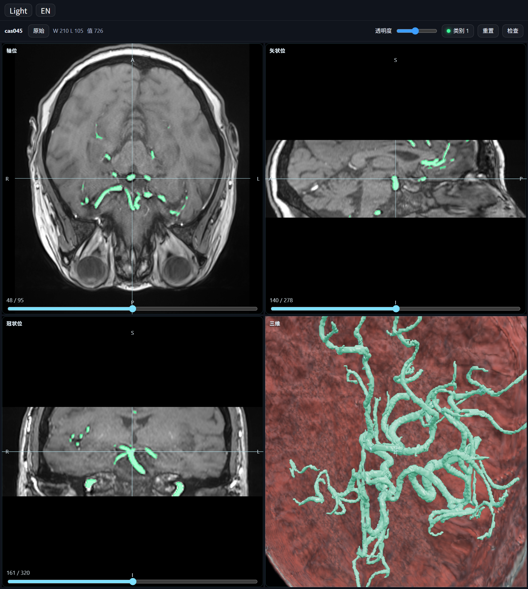

# MedView

[中文](README.md)

A radiology viewer for the DeepSeek Harness right sidebar. It opens DICOM, NIfTI, and NRRD, overlays a paired mask on the slices, and draws each ROI class in its own color.

This release is **0.1.0-alpha.1**. The tab is named MedView in English and 医学三维 in Chinese. The slash command is `/radviewer`.

The plugin code is under the [MIT License](LICENSE).



The picture shows the interface. Green is the artery mask. Labels follow the desktop app language; this shot is the Chinese UI. The scan itself is not in this repository.

## Install

You need the DeepSeek Harness desktop app (used here on 0.2.1-rc).

1. Open **Plugins**.
2. Choose **Add plugin** → **Install a third-party plugin**.
3. Enter:

   ```
   github:RimeT/dsh-radviewer
   ```

   Repository: [github.com/RimeT/dsh-radviewer](https://github.com/RimeT/dsh-radviewer). If you already cloned it, you can enter that folder path instead.
4. Quit the desktop app completely, then open it again. MedView shows up in the right sidebar.

The viewer is already built. Installing it does not compile anything, and it does not download a sample volume.

## Open a study

Put a DICOM series, NIfTI, or NRRD file in the current chat workspace.

- Click MedView on the right, enter a folder, scan, and open a study.
- In chat, type `/radviewer` followed by a workspace file or folder.
- @-mention a DICOM folder, a `.dcm` file, a `.nii` / `.nii.gz`, or a `.nrrd` / `.nrrd.gz` / `.nhdr`. The model opens it in a sidebar tab.

`/radviewer` alone opens the study list.

Drag with the left button to change window width and level, scroll to step slices, click to place the crosshair, pan with the middle button, and zoom with the right button. The 3D cell orbits.

## Files it opens

| Format | What to point at |
| --- | --- |
| DICOM | One `.dcm`, or a folder of slices (uncompressed 16-bit little-endian) |
| NIfTI | `.nii`, `.nii.gz` |
| NRRD | `.nrrd`, `.nrrd.gz`, `.nhdr` (detached data file beside the header) |

Put the mask next to the image, with a paired name:

- `image.nii.gz` with `mask.nii.gz`, or `xxx.nii.gz` with `xxx-label.nii.gz`
- `image.nrrd` with `mask.nrrd`, or `vol.nhdr` with `vol-label.nhdr`

Class 0 is hidden. Class 1 is green, 2 is cyan, 3 is magenta.

NRRD can be raw, gzip, or ascii, including a gzip-wrapped `.nrrd.gz`. Coordinates are shown in LPS; a RAS header is flipped to LPS. bzip2, zstd, and vector or RGB volumes are outside this release.

## The case in the screenshot

The screenshot is training case cas045 from the MICCAI 2023 Cerebral Artery Segmentation Challenge (CAS 2023, also listed with SMRA 2023). The task is to segment cerebral arteries on 3D TOF-MRA of patients with symptomatic intracranial artery stenosis.

This repository keeps the picture and does not include `image.nii.gz` or `mask.nii.gz`. To view a study, get it from the challenge and open that folder from your workspace. The dataset license is [CC BY-ND 4.0](https://creativecommons.org/licenses/by-nd/4.0/): the original files may be shared with attribution, and modified dataset files may not be redistributed. MIT covers this plugin's code.

> Huijun Chen, Xihai Zhao, Haozhong Sun, Jiaqi Dou, Chenlin Du, Runyu Yang, Xiaoqi Lin, Shuwan Yu, Jiachen Liu, Chun Yuan, Niranjan Balu. Cerebral artery segmentation Challenge, MICCAI 2023. Zenodo. [https://doi.org/10.5281/zenodo.7839969](https://doi.org/10.5281/zenodo.7839969)

- Description of the data: [10.5281/zenodo.7839970](https://doi.org/10.5281/zenodo.7839970)
- Challenge: [Codalab](https://codalab.lisn.upsaclay.fr/competitions/9804)
- Overview: [SMRA CAS 2023](https://society4mra.org/cerebral-artery-segmentation-challenge-cas2023/)

## Hacking on it

```bash
npm install
npm run build
```

`npm run build` rewrites `client.js`. Restart the desktop app after a UI change.
